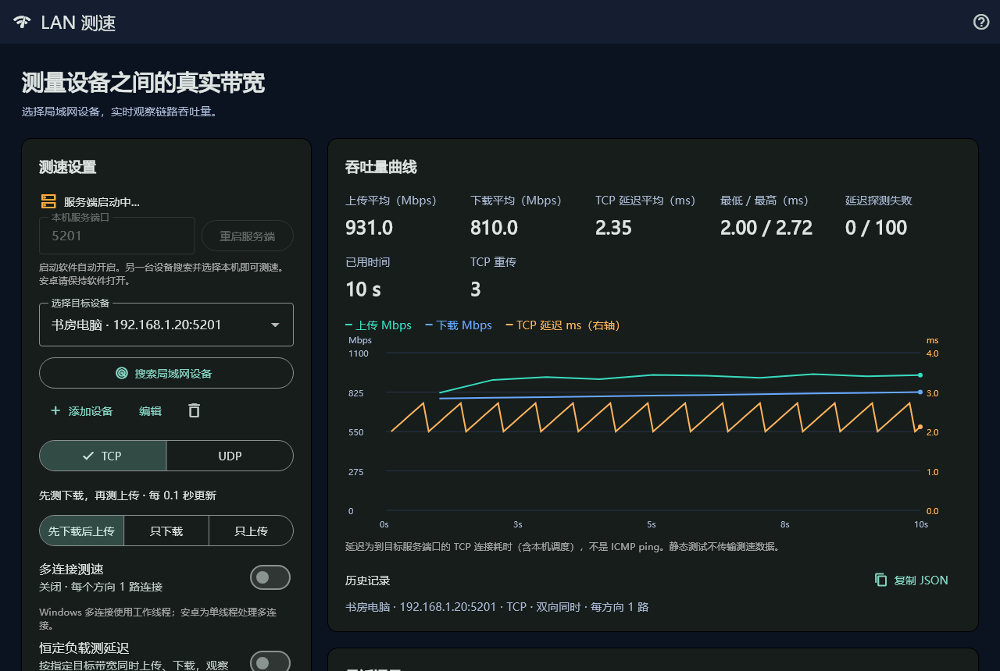
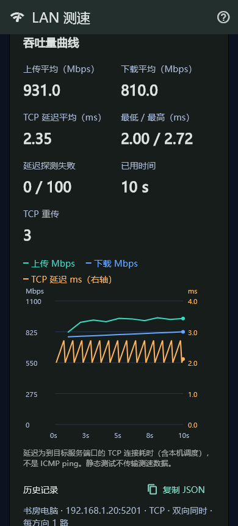
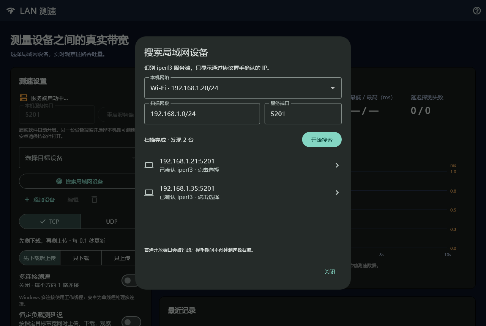

# LAN 测速 1.3.7

Windows / Android 中文图形界面，使用真实 iperf3 协议测量设备之间的带宽。

- [Windows 完整运行包](https://github.com/wliked69/lan-iperf/releases/latest/download/lan-iperf-windows.zip)：解压运行 `lan_iperf.exe`，已附带 iperf3 3.22、DLL 和 C++ 运行库。
- [安卓测试 APK](https://github.com/wliked69/lan-iperf/releases/latest/download/lan-iperf-android-debug.apk)：开发签名，Android 7.0+，arm64-v8a / armeabi-v7a / x86_64。
- [完整源码包](https://github.com/wliked69/lan-iperf/releases/latest/download/lan-iperf-source.zip)。

1.3.4 两端时长上限为 99999 秒，默认监听、发现和添加设备端口统一为 5201；升级首次正常启动会将旧监听端口恢复为 5201，此后手动修改仍保存。
1.3.5 修复长时长设置下曲线挤在左侧：横轴按已测时间推进，实时显示最近 60 秒；带宽测试完成后展示实际完整时间轴。静态延迟测试持续运行到手动停止。
保留 1.3.3 安卓服务端修复：等待旧服务进程完全退出后再启动，修复连续连接时原生输出流被关闭导致的崩溃，并显示具体启动错误。
已在 Android 16 模拟器验证 10 次重启及 5201/5202 切换、连续三轮真实 TCP 上传下载；手机实机仍需验证。

## 测速与延迟

界面新增“本机连接信息”，每 3 秒自动刷新，也可手动刷新。显示连接类型、网卡名称和系统报告的发送/接收链路速率；Wi-Fi 额外显示信号强度（dBm，Windows 可含质量百分比）、频段、信道、频率及可识别的 Wi-Fi 标准。
这些是本机网卡信息，不是 iperf3 实测吞吐量，也不是对端设备信息。多网卡分别列出，实际测速路径由系统路由决定；驱动或系统未提供的值显示“系统未提供”。
Android 新增 Wi-Fi 状态权限，部分设备可能需点击“允许读取 Wi-Fi 详情”并允许附近设备/位置信息权限；Windows 部分版本可能需要在设置中允许位置访问。不读取 GPS、不主动扫描附近热点。

软件启动自动开启服务端（默认 5201）。两端打开新版软件后，等待“服务端已开启”，
从一端搜索、选择另一端并开始测速。关闭软件会清理自己启动的服务端；安卓请保持软件打开，后台/锁屏不保证持续运行。
可用 `lan_iperf.exe --server-port=PORT` 为本次运行临时指定端口，不覆盖默认端口偏好。
服务端端口可修改、保存和重启；端口占用会显示错误，不接管其他程序的进程。

测速方向有三档：**先下载后上传（默认）、只下载、只上传**，选择会保存。
顺序模式先完成下载再自动开始上传；填写的是每阶段时长，例如 10 秒表示下载 10 秒再上传 10 秒，切换会有短暂等待。
时长范围为 1–99999 秒。超过 iperf3 单次会话的 86400 秒限制时自动建立下一段会话，段间短暂停顿，曲线和按实际传输时间加权的结果合并保存；每段原始结果也保留。
顺序模式最大为下载 99999 秒再上传 99999 秒，不含建连与切换时间。
下载阶段不显示上传曲线和上传图例，进入上传阶段后才绘制上传线；不会把尚未开始的上传画成零速率线。
两段曲线与两项平均速度合并保存，JSON 同时保留每阶段原始结果；旧版顺序历史也按阶段显示。
恒定负载测延迟模式只提供“只上传”和“只下载”，默认只下载，独立记住方向选择；关闭后恢复普通测速原来的方向。
真实统计间隔为 **0.1 秒**，不是对每秒数据插值。
绿色上传、蓝色下载、橙色 TCP 延迟；带宽使用左轴 Mbps，延迟使用右轴 ms。
操作系统调度和网络波动会影响实际采样到达时间。

- “多连接测速”关闭：每个方向 1 路连接；开启：默认 4 路，可调 1–16 路。
  Windows iperf3 3.22 为数据流使用工作线程；Android 内置 3.15 为单线程处理多个连接。
  界面标为“多连接”，不把安卓并行连接误称为多线程。
- “恒定负载测延迟”：选择**只上传或只下载**并填写总目标带宽，仅在选定方向产生带宽负载，同时探测 TCP 延迟。
  如选只下载、填 100 Mbps、多连接 4 路，则下载共 100 Mbps，每路约 25 Mbps。
  TCP 和 UDP 均可配置发送目标；实际吞吐量受链路能力、拥塞和调度影响。
- “静态延迟测试”：不发送 iperf3 带宽负载，持续进行 TCP 连接探测，直到点击“停止测试”或关闭软件。
  默认探测间隔 0.1 秒、超时 800 ms；不重叠探测，超时会延长采样间隔。
  图表只显示 TCP 延迟，按最近 60 秒滚动，保留最近 1200 个样本；统计持续累计整个测试，避免无限积累样本占用内存。
  显示平均、最低、最高连接耗时和失败次数；失败样本显示为曲线空缺。
- 带宽传输期间持续测 TCP 延迟，建连和切换阶段暂停探测以避免干扰服务端；负载下的延迟与带宽曲线同时显示。
  TCP 延迟是建立到目标服务端口的连接耗时，包含本机调度，**不是 ICMP ping**；失败次数不是 UDP 丢包率。
- 最终上传、下载平均吞吐量优先使用接收端统计；保留最近 30 次结果和延迟样本，可复制 JSON。
  兼容旧版单向测速历史。

## 本机作为服务端

其他设备真正开始测速时，显示对方 IP 和连接提示，自动展示本机服务端曲线。
服务端同样使用 0.1 秒统计；上传表示**本机发送**，下载表示**本机接收**。
测试结束保留曲线供查看。顺序测试会建立两次真实会话，服务端分别显示各阶段曲线；客户端合并展示两阶段。自动搜索的协议握手不会显示为一次真实测速。
服务端图只显示本机带宽；TCP 延迟在发起测速的客户端测量。

Windows 用受 Job Object 管理的子进程运行服务端，隐藏启动并通过管道读取逐行 JSON。
主程序正常关闭或异常结束都清理子进程。Android 客户端与服务端分别在 `:iperf` / `:iperf_server` 进程，
通过 Binder 和 JNI 回调传递实时统计；取消客户端测试不会关闭本机服务端。

## IPv4 / IPv6 与发现

“添加设备”可填写 IPv4、IPv6 或主机名。IPv6 地址直接填写，如 `fd12:3456::20`，不要加 `[]`、协议或端口；端口单独填写。
链路本地 IPv6 可能需要本机网卡作用域，例如 `fe80::1234%12`（Windows）或 `fe80::1234%wlan0`（Android），以系统支持为准。
新版服务端默认使用 iperf3 双栈监听，支持 IPv4 与 IPv6；禁用 IPv6 的系统可能回退到 IPv4。
IPv6 仍要求两端路由可达、系统启用 IPv6 并放行防火墙。

自动发现目前只支持 IPv4，识别 Wi-Fi/以太网网卡并优先选择带网关的网络。
通过 iperf3 两阶段协议握手确认，只列出运行 iperf3 的地址；不把普通开放端口列入结果。
扫描不创建测速数据流，最多 24 个并发、600 ms 单目标预算，范围 /20–/32、最多 4094 地址。
服务端繁忙、认证拒绝或超时时可能不会列出。IPv6 目标请手动添加。
外部目标需自行运行持续服务端 `iperf3 -s -p 5201`；单次模式 `-1` 可能在扫描后退出。

Windows 防火墙提示时允许 iperf3 的“专用网络”访问。TCP 测试放行 TCP 服务端口，UDP 还需放行对应 UDP 端口。
软件不自动修改系统防火墙。搜不到时检查目标服务状态、两端端口、网卡、访客 Wi-Fi 和 AP 隔离。

## 已知兼容性限制

**Windows Cygwin 服务端的 UDP 双向/多流存在上游兼容性问题，本机也复现了启动超时。**
Windows 上的普通单连接 UDP“下载后上传”已通过本机实测；UDP 多连接/双向建议改用 TCP，或使用兼容的 Linux/安卓等服务端。安卓实际组合仍待真机验证。
客户端在 8 秒未收到首个统计时终止启动，并显示原因，避免长时间等待。
详见 [ESnet 上游问题 #1992](https://github.com/esnet/iperf/issues/1992) 和 [多 UDP 流问题](https://github.com/esnet/iperf/discussions/1780)。

## 构建

当前开发环境 Flutter 3.47.7 / Dart 3.13.5。Windows 需 Visual Studio 2022 C++ 桌面工作负载和 Windows SDK。
Android 需 JDK 17+、SDK 36、NDK 28.2.13676358、CMake 3.22.1。源码固定 Android libiperf3 3.15，许可见 THIRD_PARTY.md。

```powershell
flutter pub get
flutter analyze
flutter test
flutter build windows --release
flutter build apk --release
.\scripts\build.ps1 -Target windows -IperfDirectory C:\tools\iperf3
python scripts/package_source.py
```

源码/CI 构建需自行提供 Windows iperf3 3.17+、依赖和许可证；本次交付包已附带 3.22。
Android 交付为开发签名测试 APK；发布构建在本环境缺少可下载 lint 依赖。
未进行两台物理设备之间的网络实测或安卓真机验证。验证详情见 `docs/VERIFICATION.md`。

## 示例预览

下图采用固定示例数据演示，并非实际测速结果。




